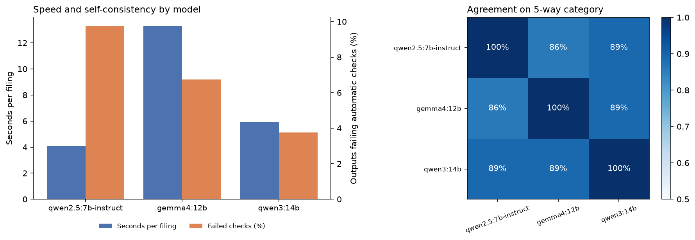
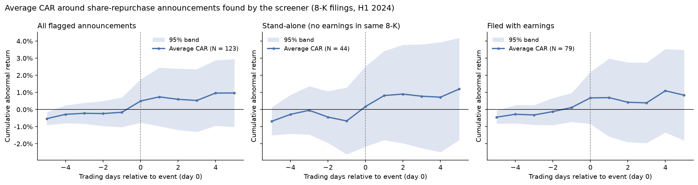

# Disclosure Screener

[](https://github.com/Yogcarmen/disclosure-screener/actions/workflows/ci.yml)

> **Status: work in progress.** The pipeline, model comparison and event study below are complete. The human audit of a stratified sample is still under way, so the accuracy figures are not yet reported, and the categories should be read as model output, not ground truth.

Find share-repurchase announcements in SEC filings with a **local LLM**, check every answer against the source text, and audit a stratified sample by hand. The flagged announcements then feed an event study of the share-price reaction.

A keyword search alone is not enough: in H1 2024, 1,158 8-K filings contain the phrase "share repurchase program", but most of them are earnings releases mentioning an *existing* programme. The task is to separate genuine new decisions from that noise and extract the terms, and to know how often the model is wrong.

## Pipeline

```
EDGAR full-text search ──► download filings ──► keep repurchase passages (± 1 paragraph)
        │                                                      │
        ▼                                                      ▼
  data/search_hits.csv                      local LLM (Qwen2.5-7B via Ollama), JSON schema, temperature 0
                                                               │
                                                               ▼
                                           automatic checks against the source text
                                                               │
                                       ┌───────────────────────┴───────────────────────┐
                                       ▼                                               ▼
                         stratified human audit sample                 event study of flagged announcements
                         (precision / recall estimates)                (event-study-toolkit, market model vs SPY)
```

**Categories** the model assigns: `new_authorization`, `increased_authorization`, `accelerated_share_repurchase`, `existing_program_only`, `not_about_buyback`. For the first three it also extracts the dollar amount, expiry, and one supporting sentence.

**Automatic checks:**

- The supporting sentence must appear in the source, verbatim or nearly so: its longest contiguous match must cover at least 90% of the quote. This catches paraphrased or stitched-together "quotes".
- The amount text must appear in the source.
- The numeric amount must agree with the amount text.

Anything failing a check is marked `needs_review`.

## Results (random sample of 400 filings, Jan–Jun 2024)

| Model category | Filings | Share | Flagged by checks |
|---|---|---|---|
| existing_program_only | 190 | 47.5% | 10 |
| new_authorization | 97 | 24.3% | 15 |
| not_about_buyback | 61 | 15.3% | 11 |
| increased_authorization | 43 | 10.8% | 3 |
| accelerated_share_repurchase | 9 | 2.3% | 0 |

- **Speed:** about 4 seconds per filing on a consumer GPU (RTX 4060 Ti), so 400 filings take about 27 minutes. Downloading took 4.5 minutes.
- **Keyword noise:** only about a third (149 of 400) of keyword hits are actual repurchase decisions.
- **Automatic checks:** 39 of 400 outputs (9.8%) failed a check and were routed to review. A first version required exact quotes and flagged 57. Inspecting those showed most were real sentences with a dropped word or a table separator in the source, so the rule was relaxed to near-verbatim. Long stitched "quotes" (one ran to 954 characters) are still caught.

**Human audit.** `python scripts/audit.py sample` draws a sample stratified by predicted category (57 filings: 12 per category, all 9 ASRs). The rare positive classes are therefore reviewed, not just the majority class. A reviewer fills `human_category` and `human_amount_usd`, and `python scripts/audit.py score` reports per-category accuracy, population-weighted accuracy, precision and estimated recall of the announcement flag, amount accuracy, and how often validator-flagged rows were really wrong. *Audit in progress; results will be added here.*

### Which local model? Three models on the same 400 filings



| Model | Sec / filing | Invalid JSON | Failing checks | Announcements flagged |
|---|---|---|---|---|
| qwen2.5:7b-instruct | 4.1 | 0 | 9.8% | 149 |
| qwen3:14b (thinking off) | 5.9 | 0 | 3.8% | 146 |
| gemma4:12b | 13.3 | 7 | 6.8% | 135 |

| Pair | Category agreement | κ (5-way) | Announcement-flag agreement | κ (flag) |
|---|---|---|---|---|
| qwen2.5-7b vs qwen3-14b | 89.3% | 0.84 | 95.3% | 0.90 |
| qwen3-14b vs gemma4-12b | 89.3% | 0.84 | 94.8% | 0.89 |
| qwen2.5-7b vs gemma4-12b | 85.8% | 0.79 | 93.0% | 0.85 |

- **Agreement:** all three models agree on 82.8% of filings. Pairwise agreement on the binary "is this an announcement?" flag is 93–95% (κ 0.85–0.90).
- **Where they disagree:** most of the 69 disagreements are borderline cases between `existing_program_only` and `new` or `increased` authorisations. They are saved to `results/model_disagreements.csv` and are the first rows worth auditing.
- **Qwen3-14B** has the fewest outputs failing the source checks (3.8% vs 9.8%), so its quotes and amounts are more often traceable to the text. It costs only about 1.5× the time of the 7B model.
- **Gemma-12B** is the slowest. Despite the enforced JSON schema, 7 of its 400 responses (1.75%) were empty or malformed JSON, each taking about 40 seconds before failing.
- **Not yet known:** agreement and passing checks are not accuracy. Which model is *right* more often will come from the human audit (`compare_models.py` adds per-model accuracy once labels exist).

### Share-price reaction to the announcements found



| Sample | N | CAR [0, 0] | CAR [−1, +1] | CAR [0, +5] | p (BMP), [0, +5] |
|---|---|---|---|---|---|
| All flagged announcements | 123 | +0.66% | +0.97% | +1.13% | 0.34 |
| Stand-alone (no earnings in same 8-K) | 44 | +0.84% | +1.26% | +1.86% | 0.17 |
| Filed with earnings | 79 | +0.56% | +0.82% | +0.72% | 0.65 |

Abnormal returns are positive, in line with the classic finding that open-market repurchase announcements earn a positive reaction of around 1–2%, and largest for stand-alone announcements, where the news is not mixed with an earnings surprise. None is statistically significant in a sample this small.

24 of 147 flagged events are dropped: 21 tickers have no price history on Yahoo Finance (mostly companies delisted or acquired since), and a few lack a full estimation window. That introduces some survivorship bias.

**Caveats.**

- Day 0 is the 8-K filing date. A press release issued after the close reacts the next day, which the [−1, +1] window covers.
- The extraction labels are the model's, not yet audited.

## Run it

Requires [Ollama](https://ollama.com) with `qwen2.5:7b-instruct` pulled, and a contact email for SEC fair access. Keep it in your shell, not in the code.

```bash
pip install -e .[analysis,dev]
export SEC_USER_AGENT="Your Name your@email.com"     # PowerShell: $env:SEC_USER_AGENT="..."

python scripts/collect.py --start 2024-01-01 --end 2024-06-30 --sample 400
python scripts/extract.py                 # resumable; --revalidate re-runs checks only
python scripts/audit.py sample --n 60     # then fill the CSV in a spreadsheet
python scripts/audit.py score
python scripts/event_study.py
python scripts/extract.py --model qwen3:14b --out results/extractions_qwen3_14b.csv   # repeat per model
python scripts/compare_models.py
pytest -q                                 # offline tests, also run in CI
```

## Design notes

- **Local model, structured output:** the JSON schema is enforced by Ollama, temperature 0 makes runs repeatable, and no filing text leaves the machine.
- **Short prompts:** only paragraphs mentioning a repurchase keyword, with one neighbouring paragraph on each side and a 4,000-character cap, are sent to the model. This keeps it fast on a laptop GPU, at the cost of occasionally missing context far from the keyword.
- **Checks before trust:** a model answer that cannot point to its source is treated as unverified, however plausible it looks.
- **Event study** uses [event-study-toolkit](https://github.com/Yogcarmen/event-study-toolkit): market model vs SPY, estimation days −250 to −11, with cross-sectional, BMP and sign tests.

## Structure

```
screener/
  edgar.py      EDGAR full-text search + cached document download
  text.py       HTML -> paragraphs, repurchase passage selection
  llm.py        prompt, JSON schema, Ollama call
  validate.py   evidence / amount checks
scripts/        collect -> extract -> audit -> event_study
tests/          offline tests (no network, no LLM)
audit/          stratified review sample
assets/         README figure
```
